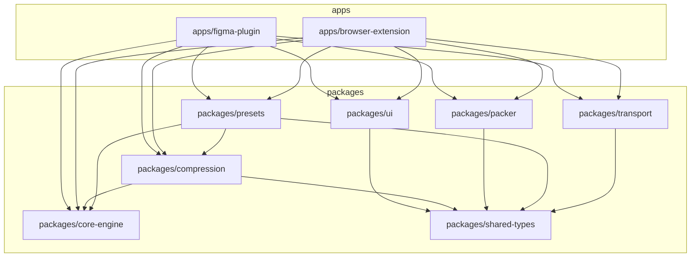

# Exportify — Architecture & Execution Plan

A monorepo with two thin apps (Figma plugin, browser extension) and four shared packages (core engine, compression, packer, UI) that own the heavy lifting.

## 1. Recommended Tech Stack

### 1.1 Monorepo & Build

- **Workspace tool**: `pnpm` (with `pnpm-workspace.yaml`).
- **Build orchestrator**: `Turborepo` for incremental builds, caching, and parallel pipelines (`build`, `lint`, `test`, `typecheck`).
- **Bundlers**:
  - Apps use **Vite 5** with custom configs to produce the Figma plugin bundle and the MV3 extension bundle.
  - Packages use **tsup** (ESM + CJS + d.ts) for distributable libraries.
- **TypeScript**: 5.6+, `tsc --noEmit` in CI, project references between packages.
- **Quality**: ESLint (flat config) + Prettier + `typescript-eslint` strict; `lint-staged` + `simple-git-hooks`.

### 1.2 UI Layer

- **Framework**: React 18 + TypeScript (your selection).
- **State management**: **Zustand** with slice-based stores. Lightweight, works equally well inside the Figma iframe, the extension popup, and the service worker message channel. No Redux ceremony.
- **Styling**: **Tailwind CSS v3** with a shared design-token layer in `packages/ui/src/theme`. Theme variables for both light and dark are exposed as CSS custom properties so Figma's iframe and the extension adopt them through `prefers-color-scheme` plus an explicit toggle.
- **Components**: Custom primitives (Button, Input, Select, Table, Checkbox, Tabs, Tooltip) — no Material/Chakra to keep bundle small and Figma-plugin-friendly.
- **Forms / schema**: **Zod** for preset validation, rename-pattern validation, and message-bridge schemas.
- **Icons**: `lucide-react` (tree-shakable, single SVG per icon).

### 1.3 Asset Processing (100% client-side)

- **SVG optimization**: `svgo` (the JS port; configurable plugin set via `preset-default` minus a denylist for IDs/classes the user may reference).
- **Raster compression** (all WebAssembly, no native codecs):
  - `@jsquash/webp` (libwebp)
  - `@jsquash/png` (OxiPNG via WASM)
  - `@jsquash/jpeg` (MozJPEG via WASM)
  - Resize via `createImageBitmap` + `OffscreenCanvas` for matrix export.
  - Fallback: `canvas.toBlob` for environments where WASM init fails.
- **Worker bridge**: **Comlink** to expose the compression API inside a Web Worker, with `@shopify/p-limit`-style bounded concurrency.
- **ZIP packaging**: `fflate` (streaming, sync or async, tiny footprint, works in workers).
- **Image fetcher in Figma**: `figma.createImage` returns `Uint8Array`; bytes are passed across the sandbox→iframe boundary via `postMessage` with `Transferable`.

### 1.4 Testing

- **Unit**: Vitest (fast, ESM-native, works in jsdom and node environments).
- **End-to-end**:
  - Figma plugin: Vitest + `figma-api-stub` for sandbox logic; manual smoke in a real Figma file.
  - Browser extension: **Playwright** with the Chromium build for MV3, loading the unpacked extension.

## 2. Core Architecture & Folder Structure

### 2.1 Module Dependency Graph



### 2.2 Repository Layout

```
exportify/
  pnpm-workspace.yaml
  turbo.json
  tsconfig.base.json
  package.json
  .nvmrc
  README.md

  apps/
    figma-plugin/
      src/
        sandbox/            # figma.* API surface (entry: code.ts)
          index.ts
          image.ts          # figma.createImage wrappers
          selection.ts      # walks current selection
          bridge.ts         # message router
        ui/                 # iframe entry (entry: ui.html)
          main.tsx
          App.tsx
          routes/
        plugin.json
      vite.config.ts
      build.mjs             # bundles sandbox + ui into dist/
      README.md

    browser-extension/
      src/
        background/         # MV3 service worker
          service-worker.ts
        content/            # content script (page asset interception)
          index.ts
        popup/              # toolbar popup
          main.tsx
          App.tsx
        options/            # full options page
          main.tsx
          App.tsx
        offscreen/          # OffscreenDocument for heavy work
          worker.ts
      public/
        icons/              # 16/32/48/128
        manifest.json       # MV3
      vite.config.ts
      README.md

  packages/
    core-engine/            # pure TS, no DOM, runs anywhere
      src/
        rename/
          casing.ts         # kebab / snake / camel / pascal
          placeholders.ts   # {width} {height} {format} {index} {date}
          regex.ts          # safe find/replace
          sanitize.ts       # strip special chars, NFC normalize
          index.ts
        folder/
          rules.ts          # tag- and category-based nesting
          tree.ts           # build path tree, dedupe collisions
        types/
          asset.ts
          preset.ts
          pipeline.ts
        index.ts
      tests/

    compression/
      src/
        svg.ts              # SVGO wrapper
        raster.ts           # @jsquash/{webp,png,jpeg} wrappers
        matrix.ts           # @1x/@2x/@3x generator
        quality.ts          # quality curves per format
        worker.ts           # Comlink-exposed API
        index.ts
      public/
        wasm/               # libwebp.wasm, oxipng.wasm, mozjpeg.wasm
      tests/

    packer/
      src/
        zip.ts              # fflate streaming zip
        folder-tree.ts      # build tree from core-engine rules
        index.ts
      tests/

    presets/
      src/
        react-native.ts
        web-app.ts
        marketing.ts
        icon-library.ts
        custom.ts           # user-defined preset shape
        index.ts
      tests/

    ui/
      src/
        components/         # Button, Input, Select, Table, Tabs, ...
        hooks/
        theme/              # tokens.css (light/dark), ThemeProvider
        store/              # zustand slices: rename, export, presets
        icons/
        index.ts
      tailwind.config.ts
      postcss.config.cjs
      tests/

    transport/              # sandbox/iframe/service-worker bridges
      src/
        figma-bridge.ts
        extension-bridge.ts
        schemas.ts          # Zod message schemas shared with apps
        index.ts
      tests/

    shared-types/
      src/
        messages.ts
        assets.ts
        index.ts

  tooling/
    tsconfig/
      base.json
      react.json
      node.json
      lib.json
    eslint/
      base.cjs
      react.cjs
    vite/
      plugin-figma.mjs
      plugin-mv3.mjs
```

### 2.3 Key Design Rules

- `**core-engine` is pure TypeScript with zero DOM dependencies** — it runs identically in a Web Worker, a Figma sandbox, an MV3 service worker, and Node tests.
- **All cross-boundary messages are Zod-validated** in `packages/transport/schemas.ts`, so neither the Figma iframe nor the extension service worker can crash on malformed input.
- **Compression never runs on the main thread.** Both apps spawn a dedicated worker and use Comlink to call into it.
- **Presets are plain JSON** defined as Zod schemas, so they round-trip through `chrome.storage`, `figma.clientStorage`, and user import/export.

## 3. Step-by-Step Implementation Roadmap

Each phase ends with a verifiable deliverable; phases 1–5 are platform-agnostic and can be developed before either app shell exists.

### Phase 0 — Foundation (1–2 days)

- Initialize pnpm + Turborepo, `tsconfig.base.json`, ESLint flat config, Prettier, simple-git-hooks, CI on GitHub Actions.
- Set up `tooling/tsconfig` and `tooling/vite` shared configs.
- Empty app shells for both Figma and extension so `turbo run build` is green on day one.
- **Done when**: `pnpm i && pnpm build` succeeds with empty packages.

### Phase 1 — Core Rename Engine (2–3 days)

- Implement casing converters (`kebab`, `snake`, `camel`, `pascal`).
- Implement placeholder engine: `{width}`, `{height}`, `{format}`, `{index}` (zero-pad aware), `{date}` (ISO + custom format).
- Implement regex find/replace with `safe-regex` length check to prevent ReDoS.
- Implement sanitization: Unicode NFC, strip control chars, collapse whitespace, transliteration hook.
- Unit tests for each rule, each placeholder, and combined pipelines.
- **Done when**: `packages/core-engine` has >95% coverage and a single `renameBatch(input, pattern)` call returns a deterministic result for 50k items in <300 ms.

### Phase 2 — Folder Structuring (1–2 days)

- Tag/category → folder rule engine.
- Path tree builder with deterministic collision resolution (`foo.svg` → `foo-1.svg`).
- Unit tests for nested, deep, and conflicting structures.
- **Done when**: Given a list of assets with tags, the engine produces a valid folder tree with no collisions.

### Phase 3 — Compression Layer (3–4 days)

- Wrap SVGO with a configurable plugin set; expose `minifySvg(buffer): Uint8Array`.
- Wrap `@jsquash/{webp,png,jpeg}` for encode/decode; quality curves in `quality.ts`.
- Implement matrix export: scale source image to @1x, @2x, @3x via `createImageBitmap` + `OffscreenCanvas`.
- Comlink worker exposes a single `process(asset): ProcessedAsset` API.
- Memory test: 200 images @ 4K, peak heap < 1.5 GB.
- **Done when**: Worker processes 200 mixed SVG/PNG/JPEG assets in <60 s on a mid-tier laptop.

### Phase 4 — Shared UI (3–4 days)

- Theme tokens (light/dark CSS variables).
- Base components: Button, Input, Select, Checkbox, Tabs, Tooltip, Toast.
- Data table with virtualized rows for the rename preview (use `@tanstack/react-virtual`).
- Preset selector card grid with import/export.
- Zustand store slices: `renameSlice`, `exportSlice`, `presetsSlice`, `themeSlice`.
- **Done when**: UI Storybook (or MDX docs) renders all components in light and dark with no console warnings.

### Phase 5 — Packer (1 day)

- `fflate`-based streaming ZIP builder that consumes the folder tree from Phase 2.
- Atomic ZIP close: write to temp `Blob`, rename to final on success.
- **Done when**: 1000-file ZIP produced in <2 s with deterministic ordering.

### Phase 6 — Figma Plugin (3–4 days)

- `code.ts` sandbox: walk selection, collect image exports via `figma.createImage`.
- `ui.html` iframe: hosts the shared React app, with a thin `figma-bridge.ts` that translates UI events into `figma.*` calls.
- ZIP download via `figma.base64Encode` → data URL (Figma plugin sandbox cannot use `URL.createObjectURL`).
- Manifest with `documentAccess: "dynamic-page"`, `networkAccess: { allowedDomains: ["none"] }` for offline guarantee.
- **Done when**: Selecting 50 frames and clicking "Export React Native Preset" produces a downloaded ZIP with the correct structure.

### Phase 7 — Browser Extension (3–4 days)

- MV3 manifest with `host_permissions: []` (everything local), `permissions: ["storage", "downloads", "offscreen"]`.
- Popup: React app, defaults to "Open files" picker; supports drag-and-drop of multiple images.
- Service worker delegates heavy work to an **Offscreen Document** so the worker survives popup close.
- Content script optionally auto-detects `` sources on the active tab and previews them.
- ZIP download via `chrome.downloads.download({ url: blob:... })`.
- **Done when**: 100 images dropped into the popup yield a downloaded ZIP matching the active preset.

### Phase 8 — Presets & Polish (2–3 days)

- Ship three built-in presets: `react-native`, `web-app`, `marketing`.
- User-defined preset CRUD with import/export JSON, persisted to `chrome.storage` or `figma.clientStorage`.
- Live preview table: original → new name, original size → estimated compressed size, format matrix.
- Cancellation: `AbortController` propagates through worker.
- **Done when**: A user can import a preset, apply it, and re-export without leaving the UI.

### Phase 9 — Testing, Docs & Store Submission (2–3 days)

- Vitest unit suites across all packages.
- Playwright e2e for the extension (MV3 unpacked load).
- Figma plugin smoke: load into a sample file, run an export, assert ZIP contents.
- README per package, plus root README with architecture diagram and screenshots.
- Figma Community plugin listing assets (128×128 icon, cover, 4-screen walkthrough).

## 4. Potential Technical Edge Cases & Mitigations

| #   | Edge case                                 | Why it bites                                                           | Mitigation                                                                                                                                             |
| --- | ----------------------------------------- | ---------------------------------------------------------------------- | ------------------------------------------------------------------------------------------------------------------------------------------------------ |
| 1   | Memory blow-up during large batches       | Decoding 200 × 4K images in the main thread OOMs the tab               | Stream through a Web Worker, free `ImageBitmap` after each encode, cap concurrent jobs at `navigator.hardwareConcurrency - 1`                          |
| 2   | WASM init in Figma iframe                 | `@jsquash/*` WASM files are large; Figma plugin bundle limit is ~25 MB | Lazy-load WASM only on first use; code-split per format; cache in `figma.clientStorage` if possible                                                    |
| 3   | Sandbox ↔ iframe message channel          | `postMessage` copies by default; large `Uint8Array` are slow           | Use `Transferable` objects (`[buffer.buffer]`) and slice into chunks > 16 MB                                                                           |
| 4   | MV3 service worker lifetime               | Service worker dies after 30 s idle; can't hold the worker             | All heavy work runs in an **Offscreen Document**; service worker is only the message router                                                            |
| 5   | ReDoS in user-defined rename patterns     | Unbounded regex blocks the worker                                      | `safe-regex` length cap (e.g. star-height ≤ 4); Zod schema rejects unsafe patterns at preset load                                                      |
| 6   | Filename collisions in ZIP                | Multiple assets map to the same final name                             | Deterministic suffix in `core-engine/folder/tree.ts`; tests cover collisions at depth ≥ 3                                                              |
| 7   | Figma CSP and `eval`                      | Figma plugin iframes forbid inline scripts and `eval`                  | Vite build with strict CSP, no `eval` in deps; SVGO run in a worker, not inline                                                                        |
| 8   | HEIC/HEIF or non-browser-supported assets | Figma exports any format users upload; browser can't decode HEIC       | Format sniff in `compression/raster.ts`; fall back to passing the original bytes through unchanged with a warning toast                                |
| 9   | Cancellation                              | Long batch with no abort wastes time                                   | Top-level `AbortSignal` plumbed through Comlink, SVGO, jsquash encoders, and fflate                                                                    |
| 10  | Theme flicker in iframe                   | Figma iframe loads without theme hint                                  | Read `figma.clientStorage.getItemAsync('theme')` synchronously on boot; extension reads `prefers-color-scheme` then user override                      |
| 11  | Cross-origin assets in extension          | `` may be CORS-locked when dragged from a page                    | Process via Blob URL created from a `fetch` with `mode: 'cors'`; on failure show a clear error and skip that file                                      |
| 12  | ZIP integrity                             | Half-written ZIP on crash leaves a corrupt file                        | Build into a `Blob` in memory, only call `downloads.download` / Figma save once the ZIP is closed                                                      |
| 13  | Preset portability between apps           | Preset saved in Figma should work in extension (and vice versa)        | Single Zod schema in `packages/presets`; both apps use `figma.clientStorage` and `chrome.storage.local` with the same JSON shape                       |
| 14  | Browser support matrix                    | Firefox MV3 differs from Chromium MV3                                  | Target Chromium MV3 for v1; isolate platform differences in `apps/browser-extension/src/platform/*` so Firefox/Safari ports are additive, not rewrites |
| 15  | Worker init race                          | UI calls compression before worker is ready                            | Comlink `wrap` returns a proxy that buffers calls; show a "Preparing engine…" state until first call resolves                                          |

## 5. Open Items for Confirmation

- **Figma source model** (default proposed): current selection, with a page-level fallback. Confirm or change to "all pages / specific frames / tagged nodes only".
- **Browser target for v1** (default proposed): Chromium (Chrome + Edge). Firefox/Safari in a later phase.
- **Localization**: ship English only in v1?
- **Telemetry**: keep strictly opt-in and local-only (no remote reporting), or omit entirely?

## 6. Immediate Next Steps Once You Approve

1. Run the Phase 0 scaffold (workspace, Turborepo, empty app shells).
2. Stand up `packages/core-engine` and `packages/ui` skeletons with CI green.
3. Begin Phase 1 implementation in `packages/core-engine/src/rename`.
